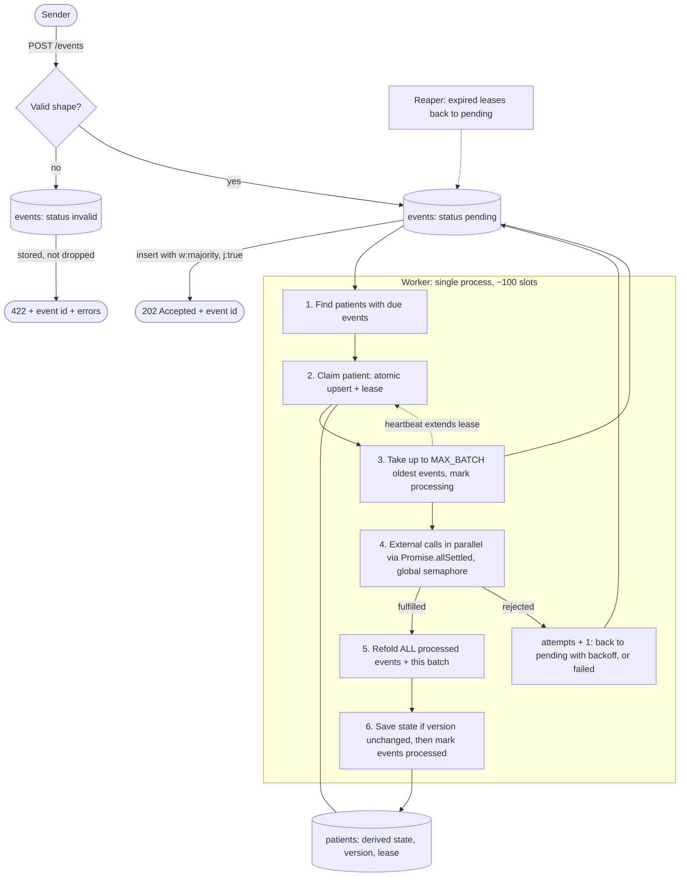

# Ingest Service

NestJS + TypeScript + MongoDB service that accepts patient events over HTTP, acknowledges them
immediately and processes them asynchronously (each event calls a ~5s external system).

## Running locally

Requirements: Docker. Nothing else is needed to run the service.

```bash
docker compose up --build
```

This starts MongoDB as a single-node replica set (initiated automatically), then the app on
http://localhost:3000. Stop it with `Ctrl+C` or `docker compose down` (add `-v` to also wipe the data).

Try it:

```bash
curl -i -X POST localhost:3000/events -H 'content-type: application/json' \
  -d '{"patientId":"p1","type":"vitals.recorded","data":{"heartRate":72},"ts":"2024-01-01T10:00:00Z"}'
curl localhost:3000/events/stats
```

Settings are environment variables (defaults in [`.env.example`](.env.example)). To change one
for the containerised app, add it under `app.environment` in `docker-compose.yml`, e.g.
`EXTERNAL_DELAY_MS: 1000`.

### Tests and load test (optional, require Node 24 on the host)

The test suites and the load generator run on the host against the dockerised stack:

```bash
npm install
npm test                    # unit tests (fold, semaphore) — no database needed
docker compose up -d mongo mongo-init
npm run test:e2e            # integration tests — need the Mongo from the line above
docker compose up -d        # make sure the app is up, then:
npm run load-test           # 1000 events/min for 60s with duplicates, out-of-order timestamps
                            # and invalid payloads; waits for the queue to drain and checks that
                            # nothing was lost or double-stored
```

### Local development (optional)

For hot reload, run only the database in Docker and the app on the host (stop the `app` container
first, it uses the same port):

```bash
docker compose up -d mongo mongo-init
npm run start:dev           # http://localhost:3000
```

### API

- `POST /events` — `{ patientId, type, data, ts }` → `202 { id }`. A duplicate returns the same
  `202` and the **original** id. A malformed payload is stored as `invalid` and answered with
  `422 { id, errors }`.
- `GET /events/stats` — counts per status (`pending | processing | processed | failed | invalid`).

## Architecture



Two collections, by design:

- **`events`** — the source of truth and the queue. Never rewritten except for status fields.
- **`patients`** — *derived* data only: folded state, `version`, and the processing `lease`.
  It can be deleted and rebuilt by re-running the fold over `events` (covered by a test).

The domain layer (`src/domain`) — `applyEvent` and `foldPatientState` — has no Nest or Mongo
imports and is pure: no clock, no randomness, no persisted state.

## Decisions and rejected alternatives

| Decision | Why | Rejected |
| --- | --- | --- |
| 202 only after `w: majority, j: true` insert | The 202 is a promise; it must survive a crash and failover. | Acknowledging before the write (loses data); fire-and-forget queue publish. |
| Invalid payloads stored as `invalid`, answered `422` | "Never lose an event" includes malformed ones; a 4xx tells a well-behaved sender to stop retrying. | Rejecting with 400 and dropping (loses data); answering 202 (sender believes it will be processed). |
| Unique index `(patientId, type, ts)`, `ts` as `Date` | Cheap, atomic dedupe with no read-before-write race; `Date` normalises equivalent timezones. The index is partial, since invalid events have no key. | App-level "check then insert" (racy); hashing the payload. |
| MongoDB as the queue | One dependency, durable by construction, atomic claims. | Redis/Kafka/RabbitMQ: extra infrastructure and a second place where an event can be lost. |
| Unit of work is the **patient** | One owner per patient removes concurrent-fold contention by construction. | Claiming single events (concurrent folds on one patient). |
| State recomputed from scratch by a pure fold | Out-of-order arrival and crash replay become the same case; idempotence comes from purity, not from avoiding reprocessing. | Incrementally mutating persisted state (replays double-count); snapshots (see trade-offs). |
| At-least-once + idempotent fold | Exactly-once delivery is not achievable across a crash; exactly-once *effect* is. | Trying to prevent reprocessing with distributed locks. |
| Lease + heartbeat + reaper | Lease length is independent of batch size; a dead worker's lease simply expires. | One long lease (slow recovery) or no lease (stuck events). |
| `version` check on state write | Secondary guard if a lease expires while a write is in flight; up to `MAX_FOLD_RETRIES`, then `failed`. | Trusting the lease alone (clocks and GC pauses make leases advisory). |
| State saved **before** events are marked processed | A crash in between is recovered by the reaper; the reverse order could leave events "done" but absent from the state. | The reverse order, or a transaction (not needed given idempotence). |
| `Promise.allSettled` + global semaphore | 50 calls take ≈5s instead of 250s; one failure keeps its siblings' results; the semaphore protects the external API across all patients. | Sequential calls; `Promise.all`; no global limit. |
| Bounded retries with exponential backoff | Poison events must not hold slots forever, nor be silently dropped: they end `failed` with the error stored. A crash loop is also bounded, because every reaper recovery counts as an attempt. | Infinite retries; discarding. |
| Single process, ~100 in-flight slots, batched claim | The load is I/O-bound (16.7 ev/s × 5s ≈ 84 concurrent); one claim query refills all free slots. | A claim query per slot; thread/process pools. |

### Event model

`vitals.recorded` (last write wins per field), `medication.changed` (`adjusted`/`stopped` only
mean something after `started`) and `status.changed` (a state machine). Order changes the outcome
for all three. Unknown types and malformed `data` are stored and skipped by the fold, never fatal.

## Assumptions

- **`(patientId, type, ts)` identifies an event.** Risk: two genuinely different events with the
  same type and timestamp (precision loss, a device batching readings) are merged. I would ask
  senders for an `Idempotency-Key` header (or an event id) and dedupe on that instead.
- **The external API is stateless per event and tolerates concurrency.** Ordering is resolved on
  our side by the fold, so calls for one patient can run in parallel.
- `ts` must carry a timezone offset; otherwise the dedupe key would depend on the server's locale.

## Known limits

- Throughput ceiling is `min(slots, distinct patients in flight)`, because processing serialises per
  patient. With many patients, adding processes scales linearly. With few, extra processes only
  contend; the fix would be per-patient partitioning or larger batches.
- A patient whose events are all held by other processes can be re-offered as a candidate on every
  poll (candidates are scanned oldest-first); fine at this scale, a per-patient "ready" marker would
  fix it.
- A body that is not parseable JSON is rejected by Express before reaching the service, so it is
  the one kind of malformed payload that is not stored.
- An event that exhausts its retries ends `failed` and is excluded from the state until someone
  intervenes; there is no replay tooling.

## Trade-offs accepted

- The fold **re-reads the patient's whole history on every batch**. Snapshots were skipped on purpose:
  an event older than the snapshot boundary invalidates it, and the spec guarantees that happens.
- `GET /events/stats` is a full-collection aggregate: fine for a demo, not for a dashboard.
- Worker updates use the default write concern: if one is lost, the reaper reprocesses it.

## With more time

- Idempotency keys; per-type schema validation on `data`.
- A patient-level "has work" marker or change streams instead of polling; per-patient partitioning
  for low-cardinality workloads.
- Replay/inspection tooling for `failed` events; a dead-letter view.
- Metrics, tracing and alerting (lag, oldest pending age, reaper activity); readiness/liveness probes.
- A chaos test that kills the process mid-batch.
